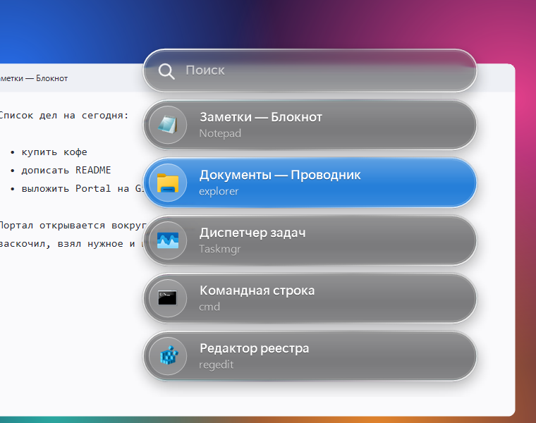
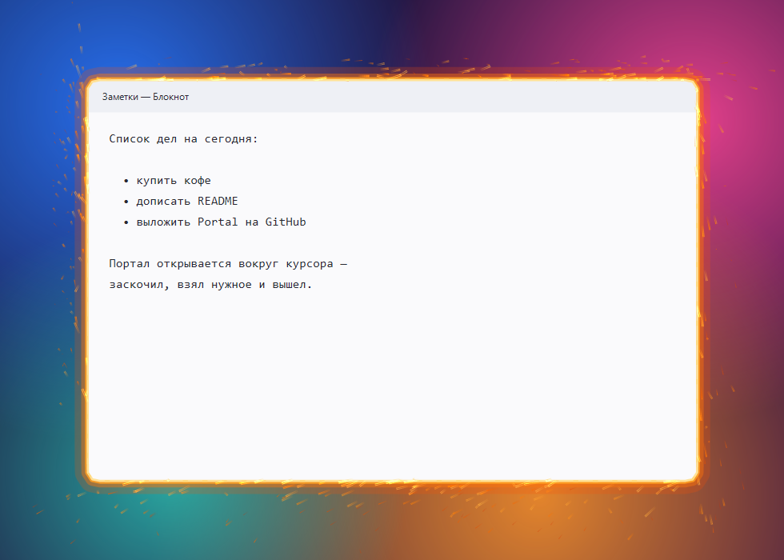

# Portal

**English** · [Русский](README.ru.md)

**Opens any running window as a "portal" right around your mouse cursor.** Hold a hotkey and a glass window list in
the style of iOS Liquid Glass springs out from under the cursor. Pick a window and it opens inside a ring of fire,
like a Doctor Strange portal, with the cursor exactly in its center. Hop in, grab what you need, click elsewhere —
the portal collapses and the window goes back exactly where it was.

  
  

## Features

- **Window list at the cursor** — like Alt+Tab, but right where you're looking. Clear glass capsules with lens-like
  refraction at the edges, app icons, the selected window highlighted in blue. Springs out with iOS-style motion.
- **Portal around the cursor** — the real window is moved to the cursor and resized, so it is fully usable: type,
  copy, drag and drop. The window is revealed from inside an expanding ring of sparks.
- **Back where it was** — click another window or press the hotkey again and the window returns to its place and
  state (a minimized window is minimized again, a maximized one is maximized again). Nothing flickers.
- **Search** — start typing a window or app name. Keyboard layout doesn't matter: typing in the Russian layout by
  mistake still finds the English name, and vice versa.
- **Smooth** — animations are synced to your monitor's refresh rate (up to 240 Hz); the ring renders on its own thread.
- **Autostart** — on first run the app installs itself to `%LOCALAPPDATA%\Portal` and starts with Windows.

> The app's interface (search placeholder, tray menu, settings comments) is in Russian.

## Requirements

- Windows 10 (version 2004 or newer) or Windows 11.
- Nothing else: the required .NET Framework 4 ships with Windows.

## Installation

**Prebuilt.** Download `Portal.exe` from [Releases](../../releases) and run it.

**From source.** Clone the repository and run `build.cmd` — it builds `Portal.exe` with the C# compiler that comes
with Windows. Then run `Portal.exe`.

On first run Portal copies itself to `%LOCALAPPDATA%\Portal`, enables autostart and restarts from there. Running a
new build from any other folder updates the installed copy.

`Portal.exe` is not code-signed, so Windows SmartScreen may warn about an unknown publisher. Click
"More info" → "Run anyway", or build it yourself from source.

## Usage

| Action | How |
|---|---|
| Open the list | hold **Alt+Q** |
| Pick a window while holding Alt | press **Q** again or hover with the mouse, then release Alt |
| Pick a window in the open list | click, **↑ ↓** + **Enter**, or start typing its name |
| Close the list | **Esc** or click outside |
| Leave the portal | click any other window or press **Alt+Q** again |

Tray icon: open settings, reload settings, autostart toggle, exit.

## Settings

File `%LOCALAPPDATA%\Portal\Portal.ini` (tray icon → open settings; after editing → reload settings):

| Key | Default | What it does |
|---|---|---|
| `Hotkey` | `Alt+Q` | Hotkey: `Ctrl`, `Alt`, `Shift`, `Win` + a key, e.g. `Ctrl+Alt+Space`, ``Alt+` `` |
| `Width` | `45` | Portal width, % of the monitor's work area |
| `Height` | `60` | Portal height, % of the monitor's work area |
| `MaxFps` | `0` | Frame rate of the fire ring while a portal is open (`0` = monitor rate). Lower means less CPU |

## Uninstall

1. Tray icon → uncheck "start with Windows" → exit.
2. Delete the `%LOCALAPPDATA%\Portal` folder.

## How it works

Everything lives in a single file, [`src/Portal.cs`](src/Portal.cs) — C# and WinForms, no third-party libraries.

- **The portal** is the window itself: Portal changes its position and size (`SetWindowPlacement` / `SetWindowPos`)
  and remembers how it was. The window's own system animations are disabled during the move
  (`DWMWA_TRANSITIONS_FORCEDISABLED`), and the spots where it disappears or appears are covered with a screenshot that
  smoothly fades away.
- **The glass** — a screenshot of what's under the list is blurred and refracted at the edges of each capsule, like
  a thick lens (with a touch of chromatic aberration). Capsules are pre-rendered on a background thread, and animation
  frames are composed from ready images by custom multi-threaded code instead of GDI+.
- **The fire ring** is a click-through, always-on-top layered window with its own thread that waits for the GPU's
  vertical blank (`D3DKMTWaitForVerticalBlankEvent`). The sparks are particles drawn straight into pixels with additive
  blending.

## Limitations

- **Windows of apps running as administrator** can't be moved unless Portal also runs as administrator.
- **WinForms apps** restore themselves to where they were minimized: if you minimize such a window right from the
  portal, it will later restore at the portal's position.
- **The list and the ring don't show up in screen recordings and streams** (OBS etc.): they are excluded from screen
  capture so they don't end up in the screenshots the effects are built from.
- **The hotkey is global**, including in games. If it gets in the way, change `Hotkey`.
- In a laptop's power-saving modes the animation rate may be lower than the monitor's refresh rate.

## License

[MIT](LICENSE)
